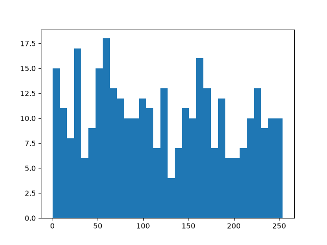

# Einstein Tile-Based Image Encryption

### An Experimental Permutation-Diffusion Image Encryption Approach

An experimental image encryption research project exploring the use of the **Einstein hat monotile** as a source of structured randomness for image permutation and diffusion.

The approach uses a passphrase-derived seed to generate a tiling pattern that influences pixel rearrangement and keystream generation.

> **Project status:** Research prototype. Not independently audited and not suitable for protecting sensitive data.

## Research Overview

Traditional image encryption approaches often use mathematical transformations to obscure image information.

This project explores an alternative approach using the aperiodic hat monotile to introduce structured geometric patterns into the encryption process.

The implementation combines two stages:

1. **Permutation:** Rearranges pixel positions using an ordering derived from the generated tiling.
2. **Diffusion:** Applies a tiling-derived keystream to the rearranged image.

## Methodology

1. A passphrase is hashed using SHA-256 to derive a seed and tiling level.
2. The hat monotile tiling is generated.
3. Pixel positions are rearranged according to the tiling-derived ordering.
4. A keystream is used in the diffusion stage.
5. Decryption reverses the transformation using the same passphrase.

## Visual Results

### Generated Tiling


### Encryption Process

| Stage | Output |
|---|---|
| Original image | `test.png` |
| Pixel scrambling | `scrambled_test.png` |
| Diffusion | `diffused_test.png` |
| Final encrypted image | `encrypted_final.png` |
| Decrypted image | `decrypted_final.png` |

### Keystream Analysis



## Experimental Results

The implementation was evaluated using five test images, including synthetic patterns, gradients, random noise and a real photograph.

| Metric | Observed result |
|---|---:|
| Successful round-trip tests | 5/5 |
| Encrypted image entropy | 7.9970 |
| Encrypted image correlation | 0.0030 |
| NPCR | 99.63% |
| UACI | 33.51% |
| Encryption time | 0.38 seconds |

These measurements describe the tested implementation and sample images. They do not establish resistance to known cryptographic attacks or demonstrate production-grade security.

## Technology Stack

- Python
- NumPy
- Pillow
- Matplotlib
- SHA-256

## Getting Started

Clone the repository:

```bash
git clone https://github.com/KochuthressiaPayankan/einstein-tile-encryption.git
cd einstein-tile-encryption
```

Create a virtual environment:

```bash
python3 -m venv venv
source venv/bin/activate
```

Install dependencies:

```bash
pip install numpy pillow matplotlib
```

Run the implementation:

```bash
python phase1_tiling.py
```

## Repository Structure

```text
einstein-tile-encryption/
├── phase1_tiling.py
├── my_tiling.png
├── test.png
├── scrambled_test.png
├── diffused_test.png
├── encrypted_final.png
├── decrypted_final.png
├── wrong_key_decrypt.png
└── keystream_histogram.png
```

## Future Work

- Expand the experimental image dataset.
- Conduct repeated benchmark trials.
- Investigate key sensitivity and differential behaviour.
- Perform independent cryptographic analysis.
- Prepare a detailed research write-up.

## Author

**Kochuthressia Payankan**  
Computer Science Undergraduate  
Sahrdaya College of Engineering and Technology

[GitHub](https://github.com/KochuthressiaPayankan)

---

*An exploration of geometric patterns, image processing and experimental encryption.*

